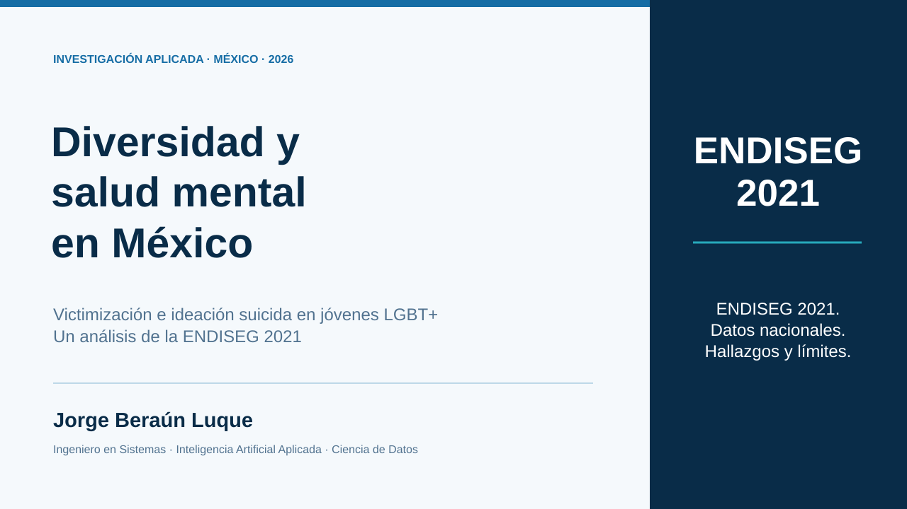
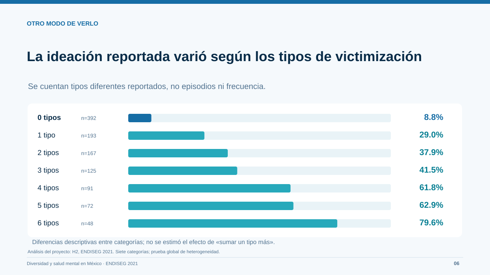
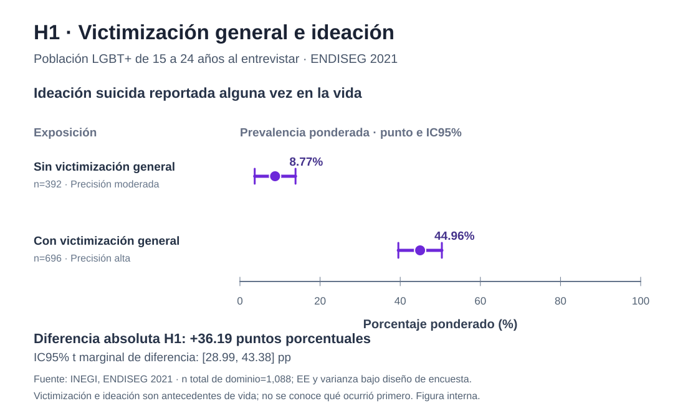
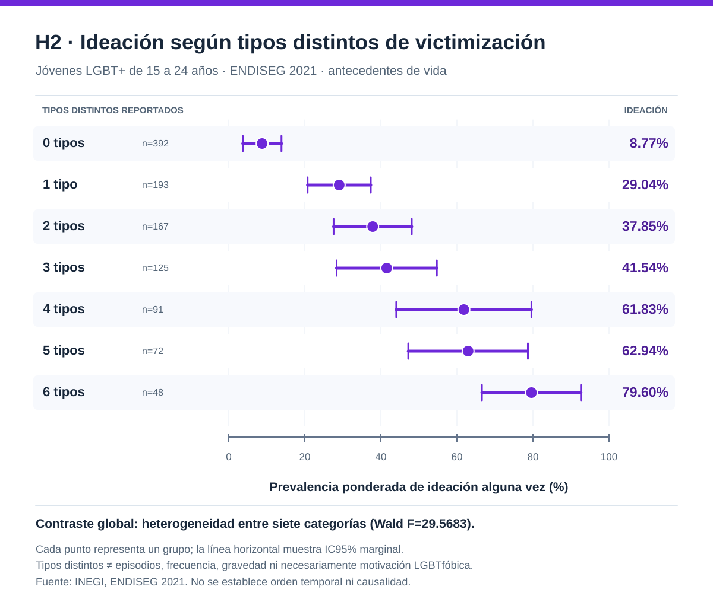

# Diversidad y salud mental en México

**Victimización e ideación suicida en jóvenes LGBT+ · ENDISEG 2021 (INEGI)**

Este proyecto surgió de una pregunta: **¿qué relación existe entre las experiencias de victimización y los antecedentes de ideación suicida entre jóvenes LGBT+ en México?** La investigación combina datos oficiales, análisis reproducible y comunicación comprensible para audiencias no estadísticas.

**Dirección del proyecto:** **Jorge Beraún Luque**  
*Ingeniero en Sistemas | Inteligencia Artificial Aplicada | Ciencia de Datos*

## La presentación, de un vistazo

Una muestra visual de tres láminas de la presentación ejecutiva B. Cada imagen abre el PDF completo de **17 diapositivas**.

**Portada · Diapositiva 1**

**Hallazgo principal · Diapositiva 5**

**Tipos distintos de victimización · Diapositiva 6**

**[Ver las 17 diapositivas (PDF)](presentacion/Diversidad_y_salud_mental_Mexico_presentacion_B.pdf)** · [Descargar PowerPoint editable](presentacion/Diversidad_y_salud_mental_Mexico_presentacion_B.pptx) · [Leer el guion](presentacion/guion_17_diapositivas.md)

*Estas vistas reproducen el contenido de láminas seleccionadas en SVG; para consultar exactamente la presentación original, abre el PDF. Las cifras muestran asociaciones, no relaciones causales.*

## Tres hallazgos para entender el estudio

**1. Una diferencia documentada por el INEGI.** Entre personas de **15 años y más**, el INEGI informó antecedentes de ideación suicida alguna vez en **26.1% de la población LGBTI+** y **7.9% de la población no LGBTI+**. Es información publicada por el INEGI, **no un contraste nuevo de este estudio**. [Comunicado 340/22, p. 14](https://www.inegi.org.mx/contenidos/saladeprensa/boletines/2022/endiseg/Resul_Endiseg21.pdf).

**2. La asociación dentro de jóvenes LGBT+ de 15–24 años.** Entre **1,088 entrevistas** del dominio estudiado, la prevalencia ponderada de ideación alguna vez fue **8.77%** entre quienes no declararon ninguno de seis tipos de victimización general y **44.96%** entre quienes declararon al menos uno. La diferencia fue **36.19 puntos porcentuales** (IC95%: **28.99–43.38 pp**).

**3. Las experiencias reportadas no fueron iguales.** La prevalencia varió entre siete categorías del número de **tipos diferentes** de victimización (0–6). La prueba global detectó heterogeneidad, pero **no demuestra causalidad ni un efecto lineal por cada tipo adicional**.

**Qué significan estos resultados:** se estudian antecedentes *alguna vez en la vida*, no riesgo actual. La victimización medida es general: **no toda experiencia se atribuye necesariamente a LGBTfobia**. Una encuesta transversal tampoco permite determinar qué ocurrió primero ni explicar causas individuales.

## Conoce los resultados y su respaldo

**Presentación ejecutiva B · 17 diapositivas**

- **[Ver la presentación completa (PDF)](presentacion/Diversidad_y_salud_mental_Mexico_presentacion_B.pdf)** — lectura directa desde GitHub.
- [Descargar la versión editable (PowerPoint)](presentacion/Diversidad_y_salud_mental_Mexico_presentacion_B.pptx) — archivo de trabajo.
- [Consultar el guion de las 17 diapositivas](presentacion/guion_17_diapositivas.md) — texto de apoyo, mensajes y fuentes.
- [Informe metodológico](docs/informe_metodologico.md) — población, medidas, ponderación, incertidumbre y limitaciones.
- [Fuentes y comparabilidad](docs/fuentes_y_contexto.md) — INEGI, Trevor Project y literatura científica, sin mezclar universos.
- [Tablas agregadas H1](datos/h1_resumen_ponderado.csv) y [H2](datos/h2_resumen_ponderado.csv) — resultados auditables.
- [Script de visualización](scripts/graficas_agregadas.py) y [notebook de lectura](notebooks/consulta_agregados.ipynb).

La presentación B ya está publicada en **PDF y PowerPoint** dentro de `presentacion/`; el PDF es la forma recomendada de consulta y el guion sirve como apoyo.

## Cómo se hizo

Se trabajó con la **ENDISEG 2021 del INEGI**, que contiene **44,189 entrevistas** en su módulo relevante. El dominio de esta investigación corresponde a **1,088 jóvenes LGBT+ de 15 a 24 años**, no a 44,189 jóvenes LGBT+. La exploración y la integración de archivos precedieron a definiciones de variables, análisis ponderados y comprobaciones entre Python y R (`survey`). La ejecución técnica integral en el equipo local se reportó como **10/10 comprobaciones PASS** según consola aportada por el responsable; esto **no es una revisión académica por pares**.

**Herramientas:** Python · pandas · Jupyter · DuckDB · SQL · R (`survey`) · `uv` · Git/GitHub · **GPT-6 (OpenAI)**.

Jorge Beraún Luque definió y dirigió la investigación, participó en la exploración, coordinó tecnologías, formuló decisiones metodológicas y evaluó los resultados. **GPT-6 fue una herramienta de asistencia** para código, análisis, comprobaciones y redacción: no fue un coautor ni un investigador independiente. No se afirma que todos los cálculos avanzados fueran programados manualmente. [Atribución y alcances](docs/atribucion_y_alcances.md).

### Reproducibilidad y privacidad

El código público de visualización **reproduce gráficas a partir de tablas agregadas**; no vuelve a estimar los contrastes inferenciales a partir de microdatos. No se redistribuyen datos de entrevistas, archivos privados, historia personal sensible ni tablas retenidas por control de privacidad. Los datos originales se obtienen del [INEGI](https://www.inegi.org.mx/programas/endiseg/2021/).

Este estudio no representa aprobación ni patrocinio del INEGI, The Trevor Project o Google. Consulta [condiciones de reutilización](REUTILIZACION.md).